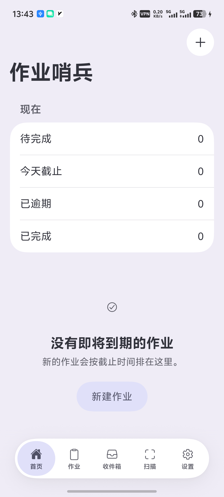
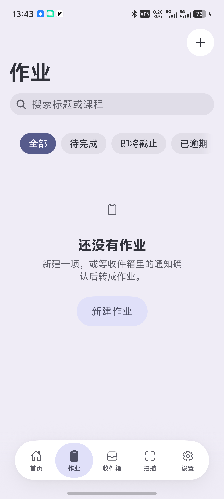
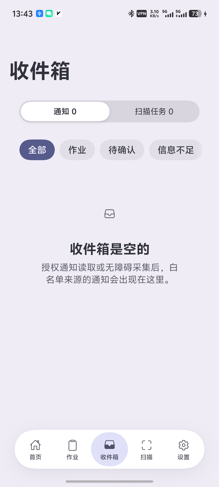
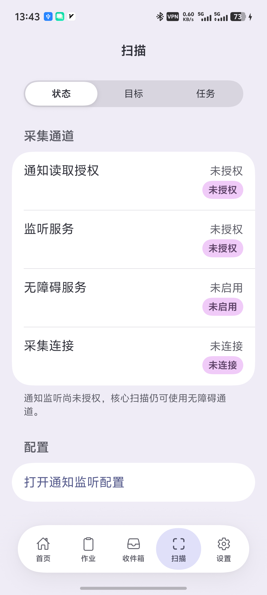
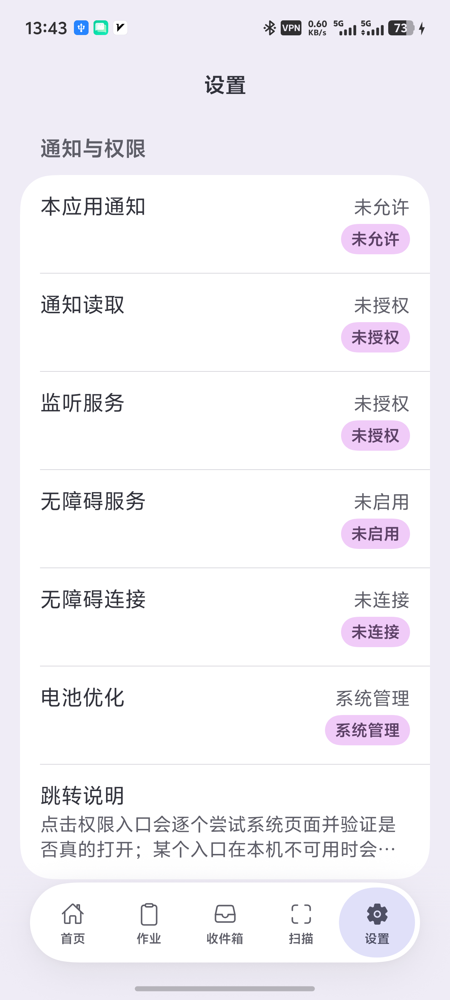

# Homework Sentinel / 作业哨兵

**本地优先的作业通知整理工具**：把你收到的教学应用通知整理成作业清单，支持截止时间、收件箱确认、扫描与本地 JSON 备份。

当前版本：**0.1.8（versionCode 9）**  
下载：见 [Releases](https://github.com/XiaozheQAQ/HS2/releases/tag/v0.1.8)  
使用教程：[使用教程.txt](使用教程.txt)

> 本仓库只发布安装包、截图和使用教程；完整源码暂不开放。

## 截图

| 首页 | 作业 | 收件箱 |
|---|---|---|
|  |  |  |

| 扫描 | 设置 |
|---|---|
|  |  |

## 功能

- **通知采集**：通过系统通知使用权，把教学应用的通知收进收件箱；不上传、不联网。
- **收件箱**：按作业 / 待确认 / 信息不足筛选，查看通知原文、复制原文，人工确认后转成作业。
- **作业管理**：创建、编辑、完成、删除；截止时间、课程、说明、备注、今天截止 / 逾期分类。
- **扫描**：普通通知扫描与周期扫描（依赖系统通知使用权/无障碍授权，具体以设备为准）。
- **数据管理**：本地 JSON 导出与恢复；恢复只允许空数据库，会校验校验和并预览。
- **主题**：跟随系统 / 浅色 / 深色。
- **五个主入口**：首页、作业、收件箱、扫描、设置。

当前公开版本聚焦“通知 → 作业”这条主链路，不包含 LMS 自动捕获与系统提醒调度。

## 安装

1. 在 [Releases](https://github.com/XiaozheQAQ/HS2/releases/tag/v0.1.8) 下载：
   - 日常使用：`HomeworkSentinel-0.1.8-release.apk`
   - 开发/测试：`HomeworkSentinel-0.1.8-debug.apk`（包名带 `.debug`，可与正式版并存）
2. 允许“安装未知应用”，打开 APK 完成安装。
3. 首次启动按向导授予通知使用权（以及扫描所需的无障碍权限，可选）。

最低系统：Android 10（API 29）。

> 如果从其他签名版本切换，Android 会拒绝覆盖安装；卸载会删除本地数据，请先导出 JSON 备份。

## 隐私

- 应用未申请 `INTERNET` 权限，通知、作业和备份都留在本机。
- 导出的 JSON 备份包含通知正文等隐私内容；恢复前请确认文件来源可信。
- 卸载应用会删除本地数据库；长期保留请定期导出备份。

## 版本说明

- 0.1.8：UI 收尾，移除不再提供的功能入口；R8 优化 Release。
- 更早版本：通知采集、收件箱、作业 CRUD、数据导出/恢复、扫描与主题。

## 反馈

请在仓库 Issues 中反馈问题，附上系统版本、应用版本和复现步骤；不要上传包含个人通知内容的截图或备份。
